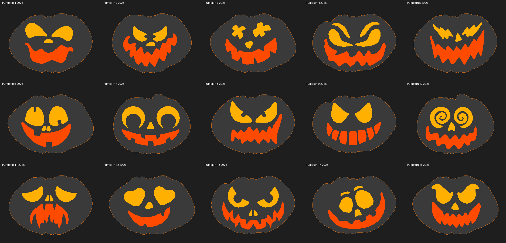

# Halloween Screen Topper – D3D Create by Dario

🇮🇹 [Italiano](#italiano) · 🇬🇧 [English](#english)

---

## Italiano

### 🎃 Halloween Screen Topper

Una zucca stampata in 3D che si appoggia sul bordo del monitor… e si **accende**!
Questo piccolo programma gratuito mostra sullo schermo, proprio dietro la zucca, una luce calda con effetto
candela, **esattamente nella forma di occhi, naso e bocca**. Lo schermo diventa la "candela" dentro la zucca.

- **15 modelli di zucca** inclusi, da scegliere dal menu
- **Effetti luce**: candela, cambio colore (palette di Halloween), arcobaleno lento, respiro
- **Due colori** separati per occhi/naso e bocca
- Tutto **morbido, senza lampi** improvvisi
- Si regola trascinando col mouse, e si ricorda posizione e impostazioni
- Italiano / inglese automatico

I modelli 3D delle zucche sono su MakerWorld: **[link MakerWorld]**

### 📥 Download

| Versione | Per chi | Dove |
|---|---|---|
| **.exe per Windows** (consigliata) | Chi non ha Python | [**Releases**](https://github.com/D3Dcreate/Halloween_screen_topper/releases) → scarica lo ZIP, estrailo, avvia `ScreenTopper_Halloween.exe` |
| **Script Python** | Chi ha Python 3.9+ | [`ScreenTopper_Halloween.py`](ScreenTopper_Halloween.py) |

Le istruzioni complete con foto sono nel PDF: [`Istruzioni_Screen_Topper_Halloween.pdf`](Istruzioni_Screen_Topper_Halloween.pdf)

> **Avviso di Windows o dell'antivirus?** Il programma è gratuito e non è firmato digitalmente (la firma costa),
> quindi al primo avvio Windows può mostrare "PC protetto": clicca *Ulteriori informazioni* → *Esegui comunque*.
> Alcuni antivirus segnalano per prudenza i programmi creati con Python: sono falsi positivi.
> Il codice sorgente è qui, completo e leggibile da chiunque.

🛡️ **Controllo antivirus**: `ScreenTopper_Halloween.exe` della versione 1.1 (lo stesso contenuto nello ZIP della release)
è stato analizzato con [VirusTotal](https://www.virustotal.com/gui/file/74c4056705ea07829624295d515cd104cffa3a385a2782ea355e9ff1a62eebe6)
il 23/10/2026: **0 segnalazioni su 70 antivirus**.
SHA256 dell'exe: `74c4056705ea07829624295d515cd104cffa3a385a2782ea355e9ff1a62eebe6`

### 🖱️ Uso in breve

1. Appendi la zucca al bordo del monitor e avvia il programma
2. Scegli il **modello** della tua zucca
3. Attiva **"Mostra contorno guida"** e trascina le luci con il tasto **sinistro** fino ai fori
4. Trascina con il tasto **destro** per la dimensione, rifinisci con le **frecce**
5. Scegli colori ed effetto: fatto! Alla prossima apertura è tutto già al suo posto

### ⚠️ Avvertenze

Il programma mostra **luci colorate che tremolano e cambiano colore**. Se tu o chi guarda lo schermo soffrite di
**epilessia fotosensibile** o siete sensibili alle luci intermittenti, **non usatelo**.
Il programma è fornito gratuitamente **"così com'è", senza alcuna garanzia**: lo usi a tuo rischio.
L'autore non risponde di danni a persone, dati, computer o monitor. Leggi la liberatoria completa nel PDF.

---

## English

### 🎃 Halloween Screen Topper

A 3D printed pumpkin that sits on top of your monitor… and **lights up**!
This small free program shows a warm candle light on the screen, right behind the pumpkin,
**shaped exactly like its eyes, nose and mouth**. Your screen becomes the candle inside the pumpkin.

- **15 pumpkin models** included, pick yours from the menu
- **Light effects**: candle, colour change (Halloween palette), slow rainbow, breathing
- **Two separate colours** for eyes/nose and mouth
- Everything is **smooth, no sudden flashes**
- Adjust it by dragging with the mouse; position and settings are remembered
- Automatic Italian / English

The 3D models of the pumpkins are on MakerWorld: **[MakerWorld link]**

### 📥 Download

| Version | For | Where |
|---|---|---|
| **Windows .exe** (recommended) | No Python needed | [**Releases**](https://github.com/D3Dcreate/Halloween_screen_topper/releases) → download the ZIP, extract it, run `ScreenTopper_Halloween.exe` |
| **Python script** | If you have Python 3.9+ | [`ScreenTopper_Halloween.py`](ScreenTopper_Halloween.py) |

Full illustrated instructions are in the PDF: [`Istruzioni_Screen_Topper_Halloween.pdf`](Istruzioni_Screen_Topper_Halloween.pdf)

> **Windows or antivirus warning?** The program is free and not digitally signed (signing costs money),
> so on first start Windows may show "Windows protected your PC": click *More info* → *Run anyway*.
> Some antivirus programs flag Python-built programs out of caution: these are false positives.
> The full source code is right here for anyone to read.

🛡️ **Antivirus check**: `ScreenTopper_Halloween.exe` of version 1.1 (the same file inside the release ZIP)
was scanned with [VirusTotal](https://www.virustotal.com/gui/file/74c4056705ea07829624295d515cd104cffa3a385a2782ea355e9ff1a62eebe6)
on 23/10/2026: **0 detections out of 70 antivirus engines**.
SHA256 of the exe: `74c4056705ea07829624295d515cd104cffa3a385a2782ea355e9ff1a62eebe6`

### 🖱️ Quick start

1. Hang the pumpkin on your monitor and start the program
2. Choose your pumpkin **model**
3. Enable **"Show outline guide"** and drag the lights with the **left** button onto the holes
4. Drag with the **right** button to resize, fine-tune with the **arrow keys**
5. Pick colours and effect: done! Next time everything is already in place

### ⚠️ Warnings

The program shows **coloured lights that flicker and change colour**. If you or anyone watching the screen has
**photosensitive epilepsy** or is sensitive to flashing lights, **do not use it**.
The program is provided free of charge **"as is", without any warranty**: use it at your own risk.
The author accepts no liability for damage to people, data, computers or monitors. See the full disclaimer in the PDF.

---

### 📄 Licenza / License

**CC BY-NC 4.0** – Puoi usare, modificare e condividere il programma citando l'autore, **ma non venderlo**. /
You may use, modify and share it with attribution, **but not sell it**.
Vedi / See [LICENSE](LICENSE).

**D3D Create by Dario** · [MakerWorld](https://makerworld.com/@dario.comico)
